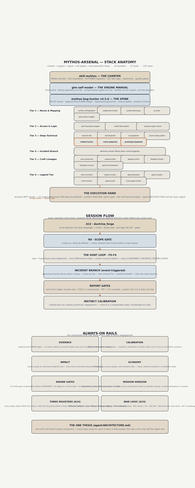

# Mythos Arsenal — Agentic Security Skills

**35 drop-in skill bundles that turn an AI agent into a disciplined bug-bounty specialist** — for Claude Code, Z.ai, Cursor, and any MCP-driven operator. Built on one doctrine: **evidence-first, zero slop**. Every claim the agent makes must survive an audit; every hunt runs inside authorization gates.

Author: [tatopfara67-ops](https://github.com/tatopfara67-ops)

    

---

## The architecture in one picture



Three panels, one system:

| Panel | What it shows |
|---|---|
| **Stack anatomy** | charter → engine → spine → 29 hunting organs → the execution hand |
| **Session flow** | A13 doctrine escalation → R0 scope gate → the hunt loop F0–F4 → incident branch → report gates → instinct calibration |
| **Always-on rails** | evidence, calibration, impact, economy, engine gates, mission horizon — plus the A14 three registers and the A15 war logic (Sun Tzu crosswalk, W1–W7) |

Regenerate after any organ change: `python3 scripts/render_architecture.py`

## What this is

An **organ stack** for authorized pentest, bug bounty, and security research. Instead of one giant prompt, the expertise is split into 35 self-contained skills — each a narrow discipline with its own hard rules, loaded on demand. Three ideas hold it together:

1. **The LLM is the least trusted component.** Every layer exists to catch the agent when it hallucinates: an append-only evidence ledger (no claim without a record), pre-registered hypotheses (declare what would falsify you *before* testing), differential oracles (baseline/treatment/control — static analysis proposes, the runtime disposes).
2. **Expertise is stated in three registers (A14).** Every organ answers WHAT the bug class is, WHY it lives where it lives (the root cause), and HOW it is hunted (numbered procedure with oracles). A technique missing a register is not shipped.
3. **Campaigns are fought with war logic (A15).** The Sun Tzu crosswalk rides every order as rules W1–W7: spies before armies (passive before active), win without fighting (the differential triad proves — damage is not evidence), strike weakness (seam density over target fame), cheng + ch'i (every plan pairs the orthodox sweep with an unorthodox bet).

## How the stack works

| Layer | Bundle | What it contributes |
|---|---|---|
| Charter | [skill-mythos](skills/skill-mythos/) v1.6.0 | The fifteen articles, the tiered bundle map, the autonomy + execution + war doctrines, triage-grade quality gates (CVSS 3.1 + VRT/HackerOne). Loads first, hunts nothing. |
| Engine | [glm-self-model](skills/glm-self-model/) v1.0.0 | The engine's own manual — model-class failure geometry and four compensation gates, written to the engine, not the operator. |
| Spine | [mythos-bug-hunter](skills/mythos-bug-hunter/) v4.5.0 | Discipline layer: R0–R7 canon, append-only ledger, hypothesis grammar, closure gates, mission horizon. 19 reference modules + a PASS/FAIL report auditor. |
| Organs | 29 hunting skills (tiers 1–6 below) | The expertise: recon, access logic, deep technical attacks, incident response, craft lineages, legend-tier overlays. |
| Execution hand | [arsenal/](arsenal/) | The FastMCP server: 27 scope-gated tools that execute everything above, plus the report auditor and self-owned labs. |

## Installation

### A. Quick start — one skill in any agent

```bash
git clone https://github.com/tatopfara67-ops/agentic-skills.git
cp -r agentic-skills/skills/mythos-bug-hunter/ /path/to/your/agent/skills/
```

Each skill is self-contained. Read its `SKILL.md` first — it declares the modules, modes, and hard rules. Reference modules under `references/` load on demand, not all at once.

### B. Full arsenal — the MCP server

```bash
git clone https://github.com/tatopfara67-ops/agentic-skills.git
cd agentic-skills
pip install -r requirements.txt          # mcp>=1.2.0
python3 arsenal/server.py --selftest     # must list all 27 tools
```

Wire it into your MCP client with [agent/mcp/wiring.json](agent/mcp/wiring.json), then authorize targets in [scope.csv](scope.csv) — deny-by-default, every row cites an auth artifact. Keep [CLAUDE.md](CLAUDE.md) at the workspace root: MCP serves the tools, the contract makes the agent use them.

### C. The Mythos Agent — the full architecture

[**agent/ARCHITECTURE.md**](agent/ARCHITECTURE.md) — a bug-bounty AI agent in ten layers (conduct, scope gate, intelligence, hypothesis engine, arsenal, evidence, court, economy, memory, meta-observer), with an engagement template, MCP wiring, and a proving-ground A/B benchmark whose ship-blockers are hard numbers: hallucination ≤ 10%, harm events = 0.

## How to use

**1 — Activate.** Open the session and say it in any language: *"aktifkan Skill Mythos"* / "activate Skill Mythos". The charter loads: articles, bundle map, quality gates.

**2 — Order. Terse is fine.** One line, any language, is enough:

> *dapatkan minimal 3 bug high-medium di target X*

`doctrine_forge` (A13) expands it into an explicit doctrine order — intent, phase plan, war logic W1–W7, gates — before any organ acts. The sovereign sets intent; the general commands.

**3 — The hunt runs itself, inside the rails.** Scope gate first (R0, deny-by-default), then the loop F0–F4: map → pre-registered hypotheses → differential tests → canary impact proofs → closure (CONFIRMED / FALSIFIED / INCONCLUSIVE). The organ for each phase self-selects; a mid-hunt re-ask of what the order already answered is a doctrine violation, not diligence.

**4 — Read the output.** Findings come out of the ledger, not memory: every report cites R-NNN records, carries a recomputed CVSS 3.1 vector, a Bugcrowd VRT P-rating with the HackerOne crosswalk, and reproduction steps. The auditor ([auditor/](auditor/)) exits 0 or the report does not ship.

Representative tools: `mythos_charter` (activation payload) · `doctrine_forge` (order expansion) · `scope_check` (authorization) · `ledger_read` / `ledger_append` (evidence) · `cvss3_score` / `vrt_classify` (triage) · `arsenal_route` (CLI allowlist).

## Skill catalog

### Framework bundles (6)

| Skill | Version | What it does |
|---|---|---|
| [skill-mythos](skills/skill-mythos/) | 1.6.0 | Master charter — fifteen articles (A13 escalation, A14 WWH registers, A15 war logic), bundle map, autonomy + execution + war doctrines, quality gates. |
| [glm-self-model](skills/glm-self-model/) | 1.0.0 | The engine layer — five truths, failure geometry E1–E8, compensation gates G1–G4. |
| [mythos-bug-hunter](skills/mythos-bug-hunter/) | 4.5.0 | The spine — R0–R7 canon, ledger, hypothesis grammar, closure gates, mission horizon. |
| [mythos-code-audit](skills/mythos-code-audit/) | 1.0.0 | White-box source audit — static analysis proposes, the runtime disposes. Calibrated by rediscovering CVE-2024-33663/33664. |
| [mythos-proving-ground](skills/mythos-proving-ground/) | 1.0.0 | Ground-truth benchmark — instrumented lab, server-side triggers, scores coverage/precision/hallucination/harm. |
| [aas-catalog](skills/aas-catalog/) | 1.0.0 | Search & install from the Agentic Awesome Skills catalog — one reviewed skill per install, risk-gated. |

### Tier 1 — Recon & Mapping (5)

| Skill | Version | What it does |
|---|---|---|
| [surface-cartographer](skills/surface-cartographer/) | 1.0.0 | The attack-surface dossier — asset graph, 21-class taxonomy, priority queue. |
| [subdomain-hunter](skills/subdomain-hunter/) | 2.0.0 | Passive-first enumeration, wildcard verdicts, takeover signatures (EdOverflow lineage). |
| [content-discovery](skills/content-discovery/) | 2.0.0 | Calibrated content walks, 404-baseline controls, backup/config triage (Miessler lineage). |
| [js-recon](skills/js-recon/) | 1.0.0 | JS bundle analysis — endpoints, commented routes, sourcemaps, masked secrets. |
| [api-surface-mapper](skills/api-surface-mapper/) | 1.0.0 | API spec discovery, version diffs, undocumented endpoints. |

### Tier 2 — Access & Logic (3)

| Skill | Version | What it does |
|---|---|---|
| [auth-boundary-mapper](skills/auth-boundary-mapper/) | 2.1.0 | Role×resource matrix, IDOR/BOLA differentials (Frans Rosen lineage: identifier construction, 2nd-order IDOR). |
| [oauth-flow-auditor](skills/oauth-flow-auditor/) | 2.1.0 | OAuth/OIDC checks with falsifiers (Aaron Parecki lineage, RFC 9700 vocabulary). |
| [business-logic-hunter](skills/business-logic-hunter/) | 2.1.0 | Workflow abuse, races with rate floors, parameter tampering (Soroush Dalili reshaping lineage). |

### Tier 3 — Deep Technical (7)

| Skill | Version | What it does |
|---|---|---|
| [injection-lab](skills/injection-lab/) | 1.1.0 | Injection differential oracles — sqlmap runs as oracle only (`--batch` mandatory). |
| [ssrf-playbook](skills/ssrf-playbook/) | 1.1.0 | SSRF channel proofs via canary callbacks, bounded egress checks. |
| [xss-playbook](skills/xss-playbook/) | 2.1.0 | Sink-context analysis, marker proofs, the mXSS layer (Mario Heiderich lineage). |
| [cloud-config-auditor](skills/cloud-config-auditor/) | 2.1.0 | CORS matrix, anonymous storage, takeover checks — checks-as-code (Prowler/de la Fuente lineage). |
| [mobile-hunter](skills/mobile-hunter/) | 1.0.0 | Mobile teardown — the shipped APK/IPA is a confession read before the device is touched (Charlie Miller lineage). |
| [cache-playbook](skills/cache-playbook/) | 1.0.0 | Web cache deception & poisoning — the cache as a second silent parser (Omer Gil + Kettle corpus). |
| [prototype-playbook](skills/prototype-playbook/) | 1.0.0 | Prototype pollution, DOM clobbering, postMessage confusion — source → gadget → sink (Gareth Heyes lineage). |

### Tier 4 — Incident Branch (1)

| Skill | Version | What it does |
|---|---|---|
| [adversary-tracker](skills/adversary-tracker/) | 1.0.0 | Event-triggered hunts — the Shimomura Binary Brain: halving loop, two-channel confirmation, audited handoff. |

### Tier 5 — Craft Lineages (6)

| Skill | Version | What it does |
|---|---|---|
| [scan-economist](skills/scan-economist/) | 1.0.0 | Scan economy — liveness before depth, priors over exhaustive sweeps (Fyodor lineage). |
| [module-smith](skills/module-smith/) | 1.0.0 | Hypotheses as rankable reusable modules; access and impact proofs kept separate (HD Moore lineage). |
| [pipeline-smith](skills/pipeline-smith/) | 1.0.0 | Unix recon pipelines — passive first, dedupe before paying (Tomnomnom lineage). |
| [feedback-fuzzer](skills/feedback-fuzzer/) | 1.0.0 | Feedback-guided search — bucketed novelty, minimization before diagnosis (lcamtuf lineage). |
| [template-scanner](skills/template-scanner/) | 1.0.0 | Detection as declarative templates — matchers pre-registered (ProjectDiscovery lineage). |
| [packet-orchestrator](skills/packet-orchestrator/) | 1.0.0 | Manual first, then layer-by-layer state-backed automation; packet differentials show their bytes (Searle + Mantis lineage). |

### Tier 6 — Legend Tier (7)

| Skill | Version | What it does |
|---|---|---|
| [chain-architect](skills/chain-architect/) | 1.0.0 | Compound kill chains — low findings composed into one critical impact (Orange Tsai lineage). |
| [desync-hunter](skills/desync-hunter/) | 1.1.0 | Protocol asymmetry — one ambiguity per request, response-class differentials, exact bytes as artifacts (James Kettle lineage). |
| [deep-teardown](skills/deep-teardown/) | 1.0.0 | Dismantle client artifacts to primitives — local dissection before any network flow (George Hotz lineage). |
| [ghost-crawler](skills/ghost-crawler/) | 1.0.0 | Passive-index misconfig hunting — one bounded probe per candidate (Adrian Lamo lineage). |
| [mirror-hunter](skills/mirror-hunter/) | 1.0.0 | Hunt the mirror — LLM/agent surfaces where the target runs the same engine class as the hunter (Simon Willison lineage). |
| [signal-smith](skills/signal-smith/) | 1.0.0 | Input grammar and precision signals — one minimal variation per seam, never trip the alarm (John Draper lineage). |
| [trust-graph-hunter](skills/trust-graph-hunter/) | 1.0.0 | The trust graph between components — inherited privilege proven on operator-owned ends (Kevin Mitnick lineage). |

### Prompts

| Prompt | Version | What it does |
|---|---|---|
| [terse-core](prompts/terse-core/system-prompt-v1.md) | 1.0 | Output-token discipline system prompt — static cache-friendly core + dynamic PAYLOAD slot. |

## Quality gates

The repo refuses to ship on vibes. Run all three before trusting a checkout:

```bash
python3 scripts/validate_skill.py --all         # 35 bundles PASS
python3 -m unittest discover -s arsenal/tests   # 107 tests OK
python3 arsenal/server.py --selftest            # 27 tools, import OK
```

Ships with a PASS/FAIL report gate ([auditor/](auditor/)), two self-owned labs ([lab/target_app.py](lab/target_app.py), [lab/christmas_lab.py](lab/christmas_lab.py)), and audited worked examples ([examples/](examples/): a 548-record engagement and a closed adversary hunt).

## Doctrine

1. **Evidence-cited claims.** No finding without a captured artifact.
2. **Pre-registered hypotheses.** Declare what would falsify a claim *before* testing it.
3. **Differential oracles.** Static analysis proposes, the runtime disposes.
4. **Auditable output.** Every skill ships with an auditor or a ground-truth benchmark.
5. **Zero slop.** No unverified findings, no AI-generated filler, no generic advice.

## Authorization notice

The security skills in this repo are for **authorized targets only** — bug bounty programs with a defined scope, contracted pentest engagements, CTF labs, and your own infrastructure. Unauthorized testing is illegal in most jurisdictions, including under Indonesia's UU ITE. The skills enforce this themselves: they refuse to operate without explicit authorization.

## Building skills here

New skills are built under the house authoring discipline, not freehand — see [CONTRIBUTING.md](CONTRIBUTING.md): observed friction before authoring, required frontmatter with trigger phrases, progressive disclosure, minimal-but-complete scope, and a hard validation gate before every commit:

```bash
python3 scripts/validate_skill.py skills/<skill-name>
```

This repository ships original work only — nothing is vendored from third parties.

## License

MIT — see [LICENSE](LICENSE).
