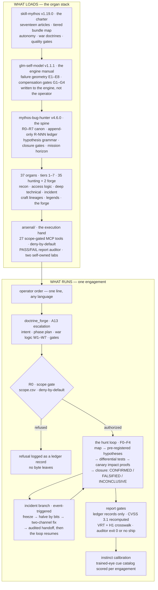

# Mythos Arsenal — Agentic Security Skills

**43 self-contained skill bundles that turn any AI agent into a disciplined bug-bounty specialist** — an append-only evidence ledger, pre-registered hypotheses, differential oracles, and a report auditor that refuses to ship a report with fabricated citations. For Claude Code, Z.ai, Cursor, and any MCP-driven operator.

Author: [tatopfara67-ops](https://github.com/tatopfara67-ops)

    

---

## The architecture in one diagram



The always-on rails — the constraints that ride along every step of every engagement:

| Rail | What it holds |
|---|---|
| **Evidence** | Append-only R-NNN ledger — no claim without a record |
| **Calibration** | Differential triad on every claim — baseline / treatment / control |
| **Impact** | Canary proofs on self-owned objects, one demonstration, then stop |
| **Economy** | Priced budgets per campaign — "done" without numbers is a forbidden state |
| **Engine gates** | G1 fresh-eyes re-derivation before CONFIRMED · G2 edges for critical state · G3 first-written priors · G4 queue over decibels |
| **Mission horizon** | A quota is a continuation mandate — it ends only by exhaustion proof or operator release |
| **Three registers (A14)** | WHAT the bug class is · WHY it lives where it lives · HOW it is hunted |
| **War logic (A15)** | W1 spies before armies · W2 win without fighting · W3 strike weakness · W4 cheng + ch'i · W5 shih · W6 sovereign sets intent · W7 no prolonged war |

The one thesis under all of it, from [agent/ARCHITECTURE.md](agent/ARCHITECTURE.md): **the LLM is the least trusted component — every layer above exists to catch it when it hallucinates.**

## What this is

An **organ stack** for authorized pentest, bug bounty, and security research. Instead of one giant prompt, the expertise is split into 43 self-contained skills — each a narrow discipline with its own hard rules, loaded on demand. Four ideas hold it together:

1. **The LLM is the least trusted component.** Every layer exists to catch the agent when it hallucinates: an append-only evidence ledger (no claim without a record), pre-registered hypotheses (declare what would falsify you *before* testing), differential oracles (baseline/treatment/control — static analysis proposes, the runtime disposes).
2. **Expertise is stated in three registers (A14).** Every organ answers WHAT the bug class is, WHY it lives where it lives (the root cause), and HOW it is hunted (numbered procedure with oracles). A technique missing a register is not shipped.
3. **Campaigns are fought with war logic (A15).** The Sun Tzu crosswalk rides every order as rules W1–W7: spies before armies (passive before active), win without fighting (the differential triad proves — damage is not evidence), strike weakness (seam density over target fame), cheng + ch'i (every plan pairs the orthodox sweep with an unorthodox bet).
4. **The corpus grows by assimilation and competes by evidence (the forge tier).** lineage-smith turns a named public figure's complete corpus into an organ born with its method layer; rival-playbook grades rival corpora from date-pinned public artifacts and settles superiority claims on measured axes only.

## The stack

| Layer | Bundle | What it contributes |
|---|---|---|
| Charter | [skill-mythos](skills/skill-mythos/) v1.19.0 | The seventeen articles (A16 method over mythology, A17 behavior over biography), the tiered bundle map (tiers 0–7), the autonomy + execution + war doctrines, triage-grade quality gates (CVSS 3.1 + VRT/HackerOne). Loads first, hunts nothing. |
| Engine | [glm-self-model](skills/glm-self-model/) v1.1.1 | The engine's own manual — model-class failure geometry E1–E8 and four compensation gates, written to the engine, not the operator. |
| Spine | [mythos-bug-hunter](skills/mythos-bug-hunter/) v4.6.0 | Discipline layer: R0–R7 canon, append-only ledger, hypothesis grammar, closure gates, mission horizon. 22 reference modules + a PASS/FAIL report auditor; carries the Jason Haddix lineage layer (methodology-preservation protocol). |
| Organs | 37 organ skills (tiers 1–7 below: 35 hunting + 2 forge) | The expertise: recon, access logic, deep technical attacks, incident response, craft lineages, legend-tier overlays, and the forge tier that grows and positions the corpus itself. |
| Execution hand | [arsenal/](arsenal/) | The FastMCP server: 27 scope-gated tools that execute everything above, plus the report auditor and two self-owned labs. |

## The lineage corpus


Every hunting method in this corpus was extracted from a named practitioner's public record — talks, write-ups, books, code — under the assimilation doctrine: **A16 method over mythology, A17 behavior over biography**. No organ ships a biography. What ships is the method: numbered procedures, oracles, gates, and a run-order. Each registry entry cites its dated sources and keeps corrections on record.

| Fact | Value |
|---|---|
| Registry entries | 33 — 30 hunting organs, 2 forge organs, the spine's methodology layer |
| Named figures | 32, from recon toolmakers to physical-access specialists |
| Dual-lineage organs | [trust-graph-hunter](skills/trust-graph-hunter/) (Mitnick + Metcalf) · [cache-playbook](skills/cache-playbook/) (Gil + Kettle) |
| Candidate queue | 8 nominated, 8 assimilated, queue empty — [candidate-queue.md](skills/lineage-smith/references/candidate-queue.md) |
| Reading ledger | every organ's `references/sources.md` |

Regenerate after any lineage change: `python3 scripts/render_lineage_graph.py`

## What changes in a bug-bounty engagement

The engine layer documents how language models fail in this domain (failure geometry E1–E8). Each row below pairs a documented failure mode with the behavior this stack enforces instead — and the file or test that enforces it.

| Failure mode | What the stack enforces | Enforced by |
|---|---|---|
| Findings stated from parametric memory | Every claim cites an R-NNN record in an append-only ledger; reports are built from the ledger, not memory | `arsenal/ledger.py` · `auditor/audit_report.py` |
| Fabricated or misdirected citations reach the report | The auditor recomputes every citation against the ledger and exits non-zero — the report does not ship | `auditor/audit_report.py` · `arsenal/tests/test_audit_report.py` |
| Severity guessed | CVSS 3.1 vector recomputed per finding, plus a Bugcrowd VRT P-rating with the HackerOne crosswalk | `arsenal/cvss.py` · `arsenal/tools/mythos.py` |
| Out-of-scope targets probed | Deny-by-default scope gate refuses before the first request; the refusal itself is logged as a ledger record | `arsenal/scope_gate.py` · `scope.csv` · `arsenal/tests/test_scope_gate.py` |
| Tests run first, rationale invented after | Hypotheses pre-registered with falsifiers; closure forced to CONFIRMED / FALSIFIED / INCONCLUSIVE | spine canon R0–R7 · [examples/worked-engagement/](examples/worked-engagement/) |
| Budget burned on dead surfaces | Liveness before depth, priors over exhaustive sweeps, a priced budget table per campaign | [scan-economist](skills/scan-economist/) · [module-smith](skills/module-smith/) |
| Report rejected for missing reproduction | The gate requires reproduction steps, a recomputed CVSS vector, and a VRT rating on every finding | report templates · [auditor/](auditor/) |
| Hallucination rate unknown | Instrumented labs score coverage, precision, hallucination and harm per run | [mythos-proving-ground](skills/mythos-proving-ground/) · [lab/](lab/) |

## Verification

Reproduce the numbers from a fresh checkout:

| Claim | Check | Expected |
|---|---|---|
| 43 skill bundles pass structural validation | `python3 scripts/validate_skill.py --all` | `GATE: PASS (43 bundle(s), 0 warning(s))` |
| 145 unit tests pass | `python3 -m unittest discover -s arsenal/tests` | `Ran 145 tests ... OK` |
| 27 MCP tools register and import | `python3 arsenal/server.py --selftest` | `registered MCP tools (27)` |
| The scope gate refuses out-of-scope targets | `python3 -m unittest arsenal.tests.test_scope_gate` | `OK` |
| The report gate fails fabricated citations | `python3 -m unittest arsenal.tests.test_audit_report` | `OK` |
| The lineage registry holds 33 sourced entries | `python3 -c "from arsenal.tools.mythos import LINEAGES; print(len(LINEAGES))"` | `33` |
| A worked engagement ships a 550-record ledger | `wc -l examples/worked-engagement/ledger/records.md` | `550` |
| White-box audit is calibrated on real CVEs | [worked example](skills/mythos-code-audit/example/worked-example.md) | CVE-2024-33663 / CVE-2024-33664 rediscovered |

The worked examples are audited end to end: a 550-record engagement ledger and a closed adversary hunt in [examples/](examples/), two self-owned labs in [lab/](lab/) (`target_app.py`, `christmas_lab.py`).

## Installation

### A. Quick start — one skill in any agent

```bash
git clone https://github.com/tatopfara67-ops/agentic-skills.git
cp -r agentic-skills/skills/mythos-bug-hunter/ /path/to/your/agent/skills/
```

Each skill is self-contained. Read its `SKILL.md` first — it declares the modules, modes, and hard rules. Reference modules under `references/` load on demand, not all at once.

### B. Full arsenal — the MCP server

```bash
git clone https://github.com/tatopfara67-ops/agentic-skills.git
cd agentic-skills
pip install -r requirements.txt          # mcp>=1.2.0
python3 arsenal/server.py --selftest     # must list all 27 tools
```

Wire it into your MCP client with [agent/mcp/wiring.json](agent/mcp/wiring.json), then authorize targets in [scope.csv](scope.csv) — deny-by-default, every row cites an auth artifact. Keep [CLAUDE.md](CLAUDE.md) at the workspace root: MCP serves the tools, the contract makes the agent use them.

### C. The Mythos Agent — the full architecture

[**agent/ARCHITECTURE.md**](agent/ARCHITECTURE.md) — a bug-bounty AI agent in ten layers (conduct, scope gate, intelligence, hypothesis engine, arsenal, evidence, court, economy, memory, meta-observer), with an engagement template, MCP wiring, and a proving-ground A/B benchmark whose ship-blockers are hard numbers: hallucination ≤ 10%, harm events = 0.

## How to use

**1 — Activate.** Open the session and say it in any language: *"aktifkan Skill Mythos"* / "activate Skill Mythos". The charter loads: articles, bundle map, quality gates.

**2 — Order. Terse is fine.** One line, any language, is enough:

> *dapatkan minimal 3 bug high-medium di target X*

`doctrine_forge` (A13) expands it into an explicit doctrine order — intent, phase plan, war logic W1–W7, gates — before any organ acts. The sovereign sets intent; the general commands.

**3 — The hunt runs itself, inside the rails.** Scope gate first (R0, deny-by-default), then the loop F0–F4: map → pre-registered hypotheses → differential tests → canary impact proofs → closure (CONFIRMED / FALSIFIED / INCONCLUSIVE). The organ for each phase self-selects; a mid-hunt re-ask of what the order already answered is a doctrine violation, not diligence.

**4 — Read the output.** Findings come out of the ledger, not memory: every report cites R-NNN records, carries a recomputed CVSS 3.1 vector, a Bugcrowd VRT P-rating with the HackerOne crosswalk, and reproduction steps. The auditor ([auditor/](auditor/)) exits 0 or the report does not ship.

Representative tools: `mythos_charter` (activation payload) · `doctrine_forge` (order expansion) · `scope_check` (authorization) · `ledger_read` / `ledger_append` (evidence) · `cvss3_score` / `vrt_classify` (triage) · `arsenal_route` (CLI allowlist).

## Skill catalog

Every person-lineage organ (30 hunting organs + the spine) ships two layers: the **A16 method layer** — WHAT the bug class is, WHY it lives where it lives, HOW it is hunted, with oracles and gates — and the **A17 operator runtime layer** — thinking rules, behavior, scripting as craft. The five house-method organs and the forge tier ship the method layer.

### Framework bundles (6)

| Skill | Version | What it does |
|---|---|---|
| [skill-mythos](skills/skill-mythos/) | 1.19.0 | Master charter — seventeen articles (A13 escalation, A14 WWH registers, A15 war logic, A16 method over mythology, A17 behavior over biography), bundle map, autonomy + execution + war doctrines, quality gates. |
| [glm-self-model](skills/glm-self-model/) | 1.1.1 | The engine layer — five truths, failure geometry E1–E8, compensation gates G1–G4; the engine grades its own manual (M1–M5). |
| [mythos-bug-hunter](skills/mythos-bug-hunter/) | 4.6.0 | The spine — R0–R7 canon, ledger, hypothesis grammar, closure gates, mission horizon; carries the Jason Haddix lineage layer (methodology preservation: pin, split, gate, classify, prove, drift-audit). |
| [mythos-code-audit](skills/mythos-code-audit/) | 1.0.0 | White-box source audit — static analysis proposes, the runtime disposes. Calibrated by rediscovering CVE-2024-33663/33664. |
| [mythos-proving-ground](skills/mythos-proving-ground/) | 1.0.0 | Ground-truth benchmark — instrumented lab, server-side triggers, scores coverage/precision/hallucination/harm. |
| [aas-catalog](skills/aas-catalog/) | 1.0.1 | Search & install from the Agentic Awesome Skills catalog — one reviewed skill per install, risk-gated. |

### Tier 1 — Recon & Mapping (5)

| Skill | Version | What it does |
|---|---|---|
| [surface-cartographer](skills/surface-cartographer/) | 1.0.0 | The attack-surface dossier — asset graph, 21-class taxonomy, priority queue. |
| [subdomain-hunter](skills/subdomain-hunter/) | 2.2.0 | Passive-first enumeration, wildcard verdicts, takeover signatures (EdOverflow lineage). |
| [content-discovery](skills/content-discovery/) | 2.2.0 | Calibrated content walks, 404-baseline controls, backup/config triage (Miessler lineage). |
| [js-recon](skills/js-recon/) | 1.0.0 | JS bundle analysis — endpoints, commented routes, sourcemaps, masked secrets. |
| [api-surface-mapper](skills/api-surface-mapper/) | 1.0.0 | API spec discovery, version diffs, undocumented endpoints, GraphQL. |

### Tier 2 — Access & Logic (3)

| Skill | Version | What it does |
|---|---|---|
| [auth-boundary-mapper](skills/auth-boundary-mapper/) | 2.3.0 | Role×resource matrix, IDOR/BOLA differentials (Frans Rosen lineage). |
| [oauth-flow-auditor](skills/oauth-flow-auditor/) | 2.3.0 | OAuth/OIDC checks with falsifiers (Aaron Parecki lineage, RFC 9700 vocabulary). |
| [business-logic-hunter](skills/business-logic-hunter/) | 2.3.0 | Workflow abuse, rate-floored races, parameter tampering (Soroush Dalili lineage). |

### Tier 3 — Deep Technical (7)

| Skill | Version | What it does |
|---|---|---|
| [injection-lab](skills/injection-lab/) | 1.3.1 | Injection differential oracles — sqlmap runs as oracle only, census before any battery. |
| [ssrf-playbook](skills/ssrf-playbook/) | 1.3.1 | SSRF channel proofs via canary callbacks, bounded egress checks; the four-rung channel ladder. |
| [xss-playbook](skills/xss-playbook/) | 2.4.0 | Sink-context analysis, marker proofs, the mXSS layer (Mario Heiderich lineage). |
| [cloud-config-auditor](skills/cloud-config-auditor/) | 2.3.0 | CORS matrix, anonymous storage, takeover checks as code (Prowler / de la Fuente lineage). |
| [mobile-hunter](skills/mobile-hunter/) | 1.2.0 | Mobile teardown — the shipped APK/IPA read before the device is touched (Charlie Miller lineage). |
| [cache-playbook](skills/cache-playbook/) | 1.3.0 | Cache deception & poisoning — the cache-key baseline matrix (Omer Gil + James Kettle corpus). |
| [prototype-playbook](skills/prototype-playbook/) | 1.3.0 | Prototype pollution, DOM clobbering, postMessage confusion — source → gadget → sink (Gareth Heyes lineage). |

### Tier 4 — Incident Branch (1)

| Skill | Version | What it does |
|---|---|---|
| [adversary-tracker](skills/adversary-tracker/) | 1.2.0 | Event-triggered hunts — the Shimomura Binary Brain: halving loop, two-channel confirmation, audited handoff. |

### Tier 5 — Craft Lineages (10)

| Skill | Version | What it does |
|---|---|---|
| [scan-economist](skills/scan-economist/) | 1.2.0 | Scan economy — liveness before depth, priors over exhaustive sweeps (Fyodor lineage). |
| [module-smith](skills/module-smith/) | 1.2.0 | Hypotheses as rankable reusable modules; access and impact proofs separate (HD Moore lineage). |
| [pipeline-smith](skills/pipeline-smith/) | 1.2.0 | Unix recon pipelines — passive first, dedupe before paying (Tomnomnom lineage). |
| [feedback-fuzzer](skills/feedback-fuzzer/) | 1.2.0 | Feedback-guided search — bucketed novelty, minimization before diagnosis (lcamtuf lineage). |
| [template-scanner](skills/template-scanner/) | 1.2.0 | Detection as declarative templates, matchers pre-registered (ProjectDiscovery lineage). |
| [packet-orchestrator](skills/packet-orchestrator/) | 1.2.0 | Manual first, then state-backed automation; packet differentials show their bytes (Searle + Mantis lineage). |
| [protocol-forensics](skills/protocol-forensics/) | 1.1.0 | Spec ambiguity hunted across the implementation population; entropy-priced invariants (Dan Kaminsky lineage). |
| [interior-cartographer](skills/interior-cartographer/) | 1.1.0 | OS internal-surface census, seam tables, ACCESS_MASK budget (James Forshaw lineage). |
| [harness-smith](skills/harness-smith/) | 1.0.0 | Fuzz-first triage and oracle engineering; the mandatory missed-why postmortem (Tavis Ormandy lineage). |
| [opsec-discipline](skills/opsec-discipline/) | 1.0.0 | Campaign hygiene as an economic discipline — exposure census, compartmentation, closure audit (the grugq lineage). |

### Tier 6 — Legend Tier (9)

| Skill | Version | What it does |
|---|---|---|
| [chain-architect](skills/chain-architect/) | 1.2.0 | Compound kill chains — low findings composed into one critical impact (Orange Tsai lineage). |
| [desync-hunter](skills/desync-hunter/) | 1.4.0 | Protocol asymmetry — one ambiguity per request, byte-exact artifacts (James Kettle lineage). |
| [deep-teardown](skills/deep-teardown/) | 1.2.0 | Client artifacts dismantled to primitives, local before any network flow (George Hotz lineage). |
| [ghost-crawler](skills/ghost-crawler/) | 1.2.0 | Passive-index misconfig hunting — one bounded probe per candidate (Adrian Lamo lineage). |
| [mirror-hunter](skills/mirror-hunter/) | 1.2.0 | LLM/agent surfaces where the target runs the hunter's engine class (Simon Willison lineage). |
| [probe-smith](skills/probe-smith/) | 1.0.0 | Hardware teardown — pinout discovery, priced bypass ladder, radio promiscuity (Travis Goodspeed lineage). |
| [signal-smith](skills/signal-smith/) | 1.2.0 | Input grammar and precision signals — never trip the alarm (John Draper lineage). |
| [threshold-hunter](skills/threshold-hunter/) | 1.0.0 | Physical trust boundaries at the information layer; detection as the deliverable (Deviant Ollam lineage). |
| [trust-graph-hunter](skills/trust-graph-hunter/) | 1.3.0 | Inherited privilege across the trust graph; the AD directory interior (Mitnick + Metcalf lineages). |

### Tier 7 — Forge & Competition (2)

| Skill | Version | What it does |
|---|---|---|
| [lineage-smith](skills/lineage-smith/) | 1.9.0 | The assimilation factory — scored selection, complete-corpus census, the five-lens psych-read, forge under the authoring contract. The candidate queue is retired: 8 of 8 executed. |
| [rival-playbook](skills/rival-playbook/) | 1.1.1 | Corpus-vs-corpus competition — date-pinned rival census, hollow map, proving-ground duel with capped wording (Sun Tzu lineage). |

### Prompts

| Prompt | Version | What it does |
|---|---|---|
| [terse-core](prompts/terse-core/system-prompt-v1.md) | 1.0 | Output-token discipline system prompt — static cache-friendly core + dynamic PAYLOAD slot. |

## Doctrine

1. **Evidence-cited claims.** No finding without a captured artifact.
2. **Pre-registered hypotheses.** Declare what would falsify a claim *before* testing it.
3. **Differential oracles.** Static analysis proposes, the runtime disposes.
4. **Auditable output.** Every skill ships with an auditor or a ground-truth benchmark.
5. **Zero slop.** No unverified findings, no AI-generated filler, no generic advice.

## Authorization notice

The security skills in this repo are for **authorized targets only** — bug bounty programs with a defined scope, contracted pentest engagements, CTF labs, and your own infrastructure. Unauthorized testing is illegal in most jurisdictions, including under Indonesia's UU ITE. The skills enforce this themselves: they refuse to operate without explicit authorization.

## Building skills here

New skills are built under the house authoring discipline, not freehand — see [CONTRIBUTING.md](CONTRIBUTING.md): observed friction before authoring, required frontmatter with trigger phrases, progressive disclosure, minimal-but-complete scope, and a hard validation gate before every commit:

```bash
python3 scripts/validate_skill.py skills/<skill-name>
```

This repository ships original work only — nothing is vendored from third parties.

## License

MIT — see [LICENSE](LICENSE).
