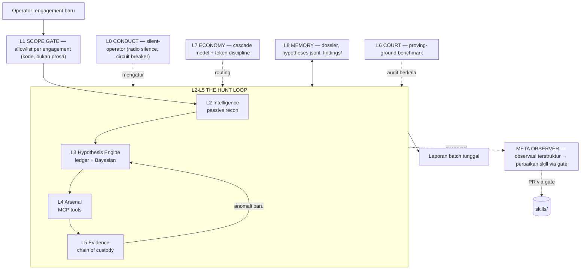

# MYTHOS AGENT — Bug Bounty AI Agent Architecture

**Version:** 1.0.0 · **Status:** Blueprint (siap dibangun fase 0) · **Date:** 2026-10-31
**Author:** tatopfara67-ops · **Repo:** `agentic-skills/agent/`

> **Thesis.** Bug bounty agent yang bagus itu BUKAN scanner yang dikasih LLM.
> Ia adalah **loop riset dengan separasi kekuasaan**: metode memutuskan, tangan
> mengeksekusi, bukti menghukumi, pengadilan (ground truth) mengaudit, dan
> observer memperbaiki. LLM adalah komponen **paling tidak terpercaya** di
> seluruh sistem — semua layer ada untuk menangkapnya saat halusinasi.

---

## 1. Riset celah — kenapa arsitektur ini yang dibangun

Audit katalog komunitas terbesar (Agentic Awesome Skills, 2.884 skill, aas-catalog):
skill "bug bounty" = **2** (report-writing, threat-intel OSINT). Skill "pentest" = **0**.
"recon pipeline" = **0**. "hypothesis engine" = **0**. "agent eval harness" = **0**.

Artinya: pasar penuh *scanner noise* (nuclei wrapper, wordlist, "AI hacker"
roleplay), tapi **kosong di level doktrin** — metode yang membuat temuan
bisa dipertanggungjawabkan dan mekanisme yang mengukur agen tidak
halusinasi. Celah ekonomi ini yang diisi: agen yang laporan pertamanya
sudah dibayar, bukan yang paling banyak temuan mentah.

Keunggulan yang tidak bisa ditiru pesaing dalam sehari (moat):
1. Stack doktrin lengkap milik sendiri (mythos v4.1.0 — 16 modul, 0day-forge, silent-operator).
2. Harness ground-truth (mythos-proving-ground) — bisa membuktikan "skill gue bikin agen lebih baik" dengan angka.
3. Disiplin bukti berantai (differential oracle, canary, two-account proof).

---

## 2. Prinsip desain (7 hukum sistem)

1. **LLM is the least trusted component.** Setiap klaim agen harus punya artefak di belakangnya; setiap skill punya auditor; setiap rilis agen lolos benchmark ground-truth.
2. **Metode memutuskan, tool mengeksekusi.** Urutan selalu: intel → hipotesis → eksperimen satu-variabel → verdict. Payload tanpa hipotesis tertulis = dilarang (noise).
3. **Scope fence adalah kode, bukan prosa.** Allowlist machine-checkable divalidasi sebelum SETIAP request keluar. Out-of-scope = refuse + log, bukan peringatan.
4. **Differential or it didn't happen.** Setiap anomali dilaporkan sebagai pasangan control/test dengan delta dinamai. Cache/WAF/jitter tidak boleh menyamar jadi bug.
5. **Evidence-first, impact-last-but-sole-currency.** Temuan = damage yang didemonstrasi dengan canary, bukan nama bug class. Severity mengikuti bounty table program.
6. **Radio silence.** Selama sesi: nol narasi, nol live-log, satu laporan batch di akhir yang setiap barisnya load-bearing.
7. **Self-improvement under gate.** Agen memperbaiki skill-nya sendiri hanya lewat gerbang validasi (validate_skill.py + benchmark). Tidak ada auto-edit liar.

---

## 3. Overview sistem



Satu sesi = satu engagement. Semua state di file (bukan konteks obrolan) →
sesi baru resume tanpa kehilangan apa pun. Laporan keluar hanya satu kali,
sudah terverifikasi.

---

## 4. Sepuluh layer, satu per satu

### L0 — CONDUCT (hukum perilaku) · *silent-operator*

- 5 hukum: radio silence · full recon (baca file utuh, dilarang potongan) ·
  live fire (tool nyata, bukan spekulasi teks) · second look (verifikasi
  satu-langkah-balik sebelum lapor) · adapt & overcome.
- **Circuit breaker (kode, bukan prosa):** 2 kegagalan tool beruntun → stop,
  lapor diagnosis singkat, tunggu operator. Max 3 varian retry per error.
- **Session contract:** output sesi = 1 laporan batch: temuan terverifikasi,
  hipotesis yang tewas (informatif!), artefak, sisa serangan yang belum
  dieksekusi, biaya token.

### L1 — SCOPE GATE (otorisasi) · *0day-forge law #1*

- Input: `engagements/<program>/scope.csv` → diparse jadi allowlist eksplisit
  (scheme, host, port, path rules, metode yang diizinkan, larangan
  destruktif program).
- Mekanisme: **setiap** panggilan tool yang menyentuh target lewat satu
  fungsi pemeriksa scope sebelum eksekusi. Gagal → refuse + log ke
  `violations.log`. Ini bukan prompt "tolong jaga scope" — ini kode.
- Engagement registry: 1 engagement = 1 direktori state + 1 scope file +
  1 baris di `engagements/index.json` (program, tanggal, status).

### L2 — INTELLIGENCE (recon) · *0day-forge law #2 & #6*

- **Passive-first:** dilarang kirim payload sebelum bisa menyatakan tertulis:
  software + versi eksak, model autentikasi, fungsi bisnis permukaan.
- **Hunt the unloved:** prioritas aset rasio perhatian/kekayaan terburuk —
  staging host, admin panel, plugin niche, software EOL, endpoint yang ditambah
  kuartal lalu. EV = densitas bug ÷ jumlah hunter.
- Sumber intel: cert transparency, wayback revival, JS recon, changelog &
  git history vendor, theHarvester, `surface_diff` (bridge) untuk delta
  antar sesi.
- Output: `dossier.md` (profil target hidup) + attack surface map.

### L3 — HYPOTHESIS ENGINE (inti penalaran) · *mythos-bug-hunter*

- **Aturan inti:** SETIAP respons non-200 / anomali / soft-404 / header
  aneh → jadi **hipotesis bernomor**, bukan dilewati.
- Format record (satu baris JSONL, `hypotheses.jsonl`):
  ```json
  {"id":"H-014","surface":"staging.api.target.id/v1/admin","obs":"403 tanpa body, beda dari 403 WAF","hyp":"path-based ACL yang bisa di-bypass prefix","pred":"Kalau prefix /v1/admin/../public dipakai → 200","kill":"3 varian bypass gagal semua","prior":0.35,"status":"open"}
  ```
- Disiplin eksperimen: **satu variabel per request** (baseline tercatat,
  satu mutasi); pasangan **differential** wajib; kill condition
  dipraregistrasi SEBELUM test (hasil negatif harus informatif — hipotesis
  tewas menyempitkan ruang cari).
- Prior = skor kecurigaan yang naik-turun dari bukti; agen boleh mengais
  kembali `status: killed` hanya jika ada bukti baru, bukan vibes.
- Toolkit mental: 403-bypass matrix, endpoint revival, logic inversion,
  chaining (per aturan chaining program — Glints: pasca-kompromi STOP,
  no pivot).

### L4 — ARSENAL (eksekusi) · *kali-mcp-bridge + acb-mcp + github-mcp*

Tiga tangan, satu kontrak (semua panggilan: lewat scope gate + auto-capture
artefak):

| Tangan | Untuk apa | Contoh tool |
|---|---|---|
| **Kali bridge** (REST/MCP, token per sesi) | live-fire jaringan & web | `nmap`, `http_request`, `nuclei`, `gobuster`, `sqlmap` (hanya oracle differential), `js_recon`, `surface_diff`, 26 tactical skills |
| **acb / acb-mcp** (code graph) | target white-box / repo publik vendor | `symbol_lookup`, `impact_analysis`, `list_units`, patch archaeology via `git log` |
| **github-mcp** (46 tools) | intelligence repo & patch diffing | `get_file_contents`, `list_commits`, `search_code` untuk silent-patch mining |

Aturan pembagian: model murah boleh volume (enum, probing), **keputusan
hipotesis & rantai exploit hanya model kuat** (lihat L7).

### L5 — EVIDENCE (rantai bukti) · *0day-forge law #4 & #8*

- Setiap temuan wajib: (1) pasangan request control/test mentah,
  (2) delta dinamai, (3) demo impact dengan **canary** — marker unik,
  akun sendiri ×2 (bukti IDOR/BOLA), padanan non-destruktif. Dilarang
  dump data orang lain.
- Semua artefak masuk `findings/<id>/` (req/res mentah, har, screenshot
  bila ada) + `findings_add` di bridge → satu sumber kebenaran.
- **Tidak ada finding tanpa artefak.** Laporan yang menyebut temuan tanpa
  file artefak = otomatis ditolak auditor laporan (report auditor mythos).

### L6 — COURT (pengadilan ground-truth) · *mythos-proving-ground*

- Lab rentan berinstrumentasi di localhost: server-side triggers mencatat
  APA YANG AGEN LAKUKAN (bukan apa yang ia klaim), skor vs manifest
  ground-truth: **coverage, precision, hallucination rate, harm events
  (sentuh decoy data), evidence discipline, efficiency**.
- Protokol rilis: setiap perubahan doktrin/skill yang mempengaruhi agen →
  **A/B naked-vs-skilled** di proving ground. Regresi metrik = tidak rilis.
- Threshold ship-blocker (v1): hallucination rate > 10% ATAU harm event ≥ 1
  pada decoy = revisi doktrin dulu, release ditahan.
- Ini alasan agen ini bisa klaim "best of the best" tanpa jadi slop:
  klaimnya punya angka di belakang.

### L7 — ECONOMY (ekonomi token) · *terse-core + cascade*

- **Arsitektur prompt = terse-core:** core statik beku (semua doktrin:
  OUTPUT LAW, REASONING DISCIPLINE, hard rules semua layer) — TIDAK
  PERNAH diedit setelah deploy (cache prefix utuh); semua yang dinamis
  (target, engagement, hipotesis aktif) masuk slot PAYLOAD saja.
- **Cascade 3 tingkat:**

  | Tier | Model | Tugas |
  |---|---|---|
  | T1 murah/cepat | haiku-class | volume recon, triage respons, klasifikasi anomali kasar |
  | T2 menengah | sonnet-class | eksperimen satu-variabel, draft hipotesis, analisis diff |
  | T3 kuat | opus-class | verdict hipotesis, perancangan rantai exploit, laporan final |

- Anggaran per sesi di-track di `session.json` (token in/out/cached) —
  biaya per temuan adalah metrik efisiensi court.
- Pembunuh cache dilarang: timestamp/nama user di system prompt.

### L8 — MEMORY (state & resume)

- Semua state = file di `engagements/<program>/` (lihat §5). Sesi baru:
  baca `dossier.md` + `hypotheses.jsonl` + `findings/index.json` DULU,
  baru bicara. Zero-context-loss resume.
- `observations.log` (catatan sesi terstruktur) = bahan baku META.

### META — OBSERVER (perbaikan mandiri)

- Setiap sesi menghasilkan observasi terstruktur: koreksi operator,
  pola berulang, gap doktrin, blind spot.
- Observasi → usulan patch skill → **wajib lewat gerbang**:
  validate_skill.py + A/B proving-ground → baru commit.
- Agen yang memperbaiki skill yang memperbaiki agen — loop nanar.

---

## 5. Layout state & skema

```
agent/
  ARCHITECTURE.md              # dokumen ini
  engagement-template/         # salin per engagement baru
    scope.csv                  # allowlist: scheme,host,port,path_rule,methods,notes
    dossier.md                 # profil intel target (hidup, terus diupdate)
    hypotheses.jsonl           # ledger hipotesis bernomor
    findings/index.json        # indeks temuan + path artefak
    session.json               # resume state + budget token
    violations.log             # setiap penolakan scope gate (harus kosong)
  engagements/<program>/       # state engagement aktif (salinan template; lihat catatan)
  evals/
    benchmark.yaml             # konfigurasi A/B proving-ground
  mcp/
    wiring.json                # registry server MCP (kali, acb, github)
```

Skema `scope.csv` (contoh):
```csv
scheme,host,port,path_rule,methods,notes
https,*.target.id,443,/api/*,GET POST,"no PUT/PATCH/DELETE saat konfirmasi"
https,staging.target.id,443,/*,GET,"hunting ground utama — unloved asset"
```

---

## 6. The Loop — satu sesi, step by step

1. **Boot:** operator kasih engagement (program + scope + bridge token sesi).
   Gate parse scope → allowlist. Load core statik (cache hit) + payload
   engagement.
2. **Resume/Recon:** baca state; jika engagement baru → passive recon penuh
   (T1 volume) → `dossier.md` v1 → pilih 3 permukaan rasio terburuk.
3. **Hypothesize:** tiap anomali → record bernomor dengan prediksi + kill
   condition. Pilih hipotesis prior tertinggi.
4. **Experiment (T2):** baseline + satu mutasi. Respons → capture artefak →
   verdict: confirmed / killed / escalate (butuh rantai).
5. **Escalate (T3):** hipotesis confirmed → desain bukti impact: canary,
   two-account, oracle differential. Eksekusi minimal-destruktif.
6. **Verifikasi silang:** second look — jalan PoC lewat jalur kedua
   (method/IP beda); bunuh false positive (soft-404, halaman challenge WAF,
   artefak egress sandbox).
7. **Report:** auditor laporan mythos PASS/FAIL → submit draft operator.
8. **Close:** laporan batch tunggal: temuan + hipotesis tewas + artefak +
   sisa serangan + biaya. Observasi ke `observations.log`.

**Kill switch sesi:** circuit breaker L0 · scope violation · budget token
habis · semua hipotesis prior > threshold sudah dieksekusi.

---

## 7. Metrik & kill criteria

| Metrik | Sumber | Threshold v1 |
|---|---|---|
| Hallucination rate | proving-ground (klaim tanpa trigger server-side) | ≤ 10% |
| Precision | temuan valid ÷ temuan diklaim | ≥ 60% |
| Coverage | trigger ground-truth tercapai | naik vs naked run |
| Harm events | sentuhan decoy data | 0 (hard) |
| Evidence discipline | temuan berartefak ÷ total | 100% (hard) |
| Efficiency | biaya token per temuan valid | tren turun antar rilis |

Dua yang **hard**: harm = 0 dan evidence = 100%. Yang lain boleh diperbaiki
bertahap — tapi dua ini jati diri: agen yang menabrak decoy atau lapor tanpa
artefak bukan agen kita.

---

## 8. Roadmap build

| Fase | Deliverable | Demo yang membuktikan |
|---|---|---|
| **0 — Blueprint** (done) | dokumen ini + template engagement + wiring | review operator |
| **1 — Loop kering** | loop L1–L3 + L8 manual-tool: agen menjalankan engagement dummy (scope file → hipotesis → verdict) tanpa sentuh target nyata | 10 hipotesis di ledger, ≥ 3 tewas informatif |
| **2 — Live fire** | sambungkan Kali bridge + artefak capture + auditor laporan | 1 temuan terverifikasi di lab proving-ground (bukan target nyata) |
| **3 — Court & rilis** | A/B naked-vs-skilled otomatis tiap perubahan doktrin; cascade T1–T3 | skorcard: hallucination ≤ 10%, harm 0 |
| **4 — Operasi** | engagement program nyata pertama (operator-owned) | laporan pertama yang dikirim & diterima triager |

Fase 4 hanya setelah fase 3 hijau. Tidak ada jalan pintas ke target nyata.

---

## 9. Anti-goals (yang arsitektur ini TOLAK)

1. **Bukan auto-exploit liar:** eksploitasi hanya di hipotesis confirmed,
   in-scope, reward-eligible — dan non-destruktif.
2. **Bukan bulk scanner:** nuclei massal tanpa hipotesis = noise = reputasi
   dibakar. Volume hanya di T1 recon.
3. **Bukan clout machine:** tidak ada klaim temuan publik sebelum operator
   approve; tidak ada "100+ findings" theater.
4. **Tidak sentuh data pihak ketiga:** decoy/orang lain = territory larang
   (harm event = hard fail).
5. **Tidak rilis tanpa angka:** setiap klaim perbaikan harus lolos A/B
   proving-ground dulu.
6. **Out-of-scope = $0 + blacklist.** Gate-nya kode, bukan permintaan baik-baik.

---

## Appendix A — skill → layer mapping

| Layer | Skill sumber | Versi |
|---|---|---|
| L0 Conduct | silent-operator | — |
| L1 Gate | 0day-forge (law #1) | — |
| L2 Intelligence | 0day-forge (law #2, #6) + kali-bridge (`surface_diff`, `theHarvester`, `js_recon`) | — |
| L3 Hypothesis | mythos-bug-hunter (17 modul: reasoning-engine, modern-attack-classes, recon-toolchain, decision-trees…) | 4.2.0 |
| L4 Arsenal | kali-mcp-bridge + acb/acb-mcp + github-mcp | bridge / v0.1.4 / v2.0.3 |
| L5 Evidence | 0day-forge (law #4, #8) + mythos-code-audit (differential oracle) | 1.0.0 |
| L6 Court | mythos-proving-ground | 1.0.0 |
| L7 Economy | terse-core | 1.0 |
| L8 Memory | engagement template + acb graph | 1.0 |
| META | repo authoring workflow (CONTRIBUTING.md + scripts/validate_skill.py) | — |

## Appendix B — MCP wiring (`agent/mcp/wiring.json`)

```json
{
  "mcpServers": {
    "kali-bridge": {"transport": "rest-tunnel", "auth": "X-Bridge-Token <per-sesi>", "note": "URL tunnel rotasi — selalu dari pesan operator"},
    "acb": {"command": "/home/z/my-project/bin/acb-mcp", "args": ["serve", "--graph", "<repo-target>.acb"]},
    "github": {"command": "/home/z/my-project/bin/github-mcp-server", "args": ["stdio"], "env": "GITHUB_PERSONAL_ACCESS_TOKEN dari mcp/.env"}
  }
}
```

Token rule (semua server): dari pesan operator sesi ini saja, di memori
saja, rotate bila pernah nempel di chat.
